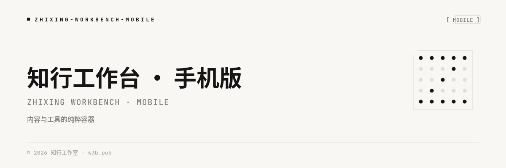

<div align="center">

# 知行工作台 · 手机版

**Zhixing Workbench · Mobile**

`知是行之始 · 行是知之成`

> 知行合一 — 内容与工具的纯粹容器
> Full-screen WebView container for content & tools

[](LICENSE)
[]()
[]()
[]()



</div>

---

**知行工作台（Zhixing Workbench）** 是一个极简的全屏 WebView 容器：把常用站点放进一个沉浸式的深色工作台，像终端一样干净、专注。支持站点管理、桌面模式、文件下载、快捷分享——移动端（React Native WebView）与 Web 端（iframe）双实现，一套代码跨三端。

A minimal full-screen WebView container that hosts your everyday sites in one immersive, terminal-clean workspace — with site management, desktop-mode browsing, file download and quick share. One codebase, three platforms: Android / iOS / Web.

## ✨ 特性 / Features

- **全屏沉浸** — 内容即界面，导航与控制元素按需浮现 / Full-screen immersion, controls appear only when needed
- **站点管理** — 添加、编辑、删除、一键切换，本地持久化 / Add, edit, remove and switch sites, persisted locally
- **桌面模式** — 以桌面浏览器标识访问，兼容更多网站布局，支持双指缩放 / Desktop user-agent mode with pinch-zoom
- **文件下载引擎** — URL / Blob 拦截，图片保存相册、任意文件系统分享 / URL & Blob download interception, save images to gallery or share via system panel
- **协议拦截** — `tel:` / `mailto:` / `sms:` 链接自动交给系统处理 / Protocol links hand off to the system
- **记住上次页面** — 冷启动自动恢复上次浏览位置 / Restores your last visited page on launch
- **手势支持** — 长按顶部呼出设置、边缘右滑返回历史 / Long-press top edge for settings, edge-swipe for history
- **深色主题** — 极深蓝黑 `#020617` + 科技蓝 `#3B82F6` / Deep-slate dark theme

## 🚀 快速开始 / Quick Start

```bash
# 1. 安装依赖 / Install dependencies (pnpm workspace)
pnpm install

# 2. 启动开发服务（Web 预览 + Express 后端）/ Start dev server
pnpm dev

# 3. 生产构建（Web）/ Production build
pnpm build
```

### 构建移动端 App / Building Mobile Apps

原生工程由 [Expo CNG](https://docs.expo.dev/workflow/continuous-native-generation/) 从 `client/app.config.ts` 自动生成（无需提交 `android/` / `ios/`）：

```bash
cd client
npx expo prebuild          # 生成原生工程 / Generate native projects
npx expo run:android       # Android
npx expo run:ios           # iOS
# 或导出产物 / or export:
npx expo export -p android --output-dir dist
```

## 📦 技术栈 / Tech Stack

| 层 Layer | 技术 / Technology |
|---|---|
| 前端 App | Expo 54 · React Native 0.81 · Expo Router 6 · TypeScript |
| WebView | react-native-webview（移动端）/ iframe（Web 端） |
| 下载 | expo-file-system · expo-media-library · expo-sharing |
| 服务端 | Express（静态托管 + `/api/v1/health` + SPA fallback） |
| 工程 | pnpm workspace monorepo · Tailwind（Uniwind） |

## 📁 目录结构 / Structure

```
├── client/                # Expo / React Native 前端
│   ├── app/               # 路由（Expo Router）
│   ├── screens/davi/      # 核心：全屏 WebView 工作台
│   ├── utils/             # 下载引擎 · 持久化 · 主题
│   ├── components/        # 通用组件
│   └── heroui/            # HeroUI Native 组件库
├── server/                # Express 服务端
├── .cozeproj/             # 平台构建脚本
└── server.js              # 生产入口
```

## 📄 协议 / License

[GNU Affero General Public License v3.0](LICENSE) — 自由使用、修改、分发；基于本项目的网络服务需开放源代码。

Free to use, modify and distribute. Network services built upon this project must disclose source code.

---

<div align="center">

**© 2026 知行工作室** · [https://w3b.pub/](https://w3b.pub/) · [support@w3b.pub](mailto:support@w3b.pub)

</div>
